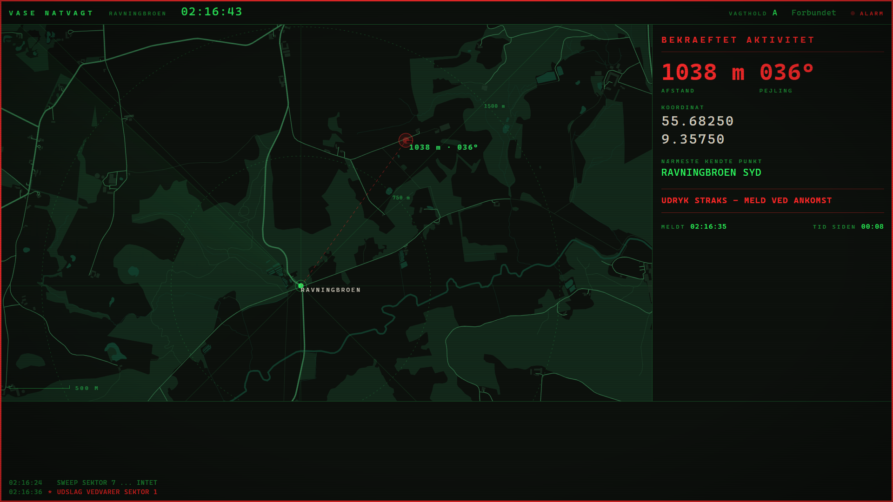
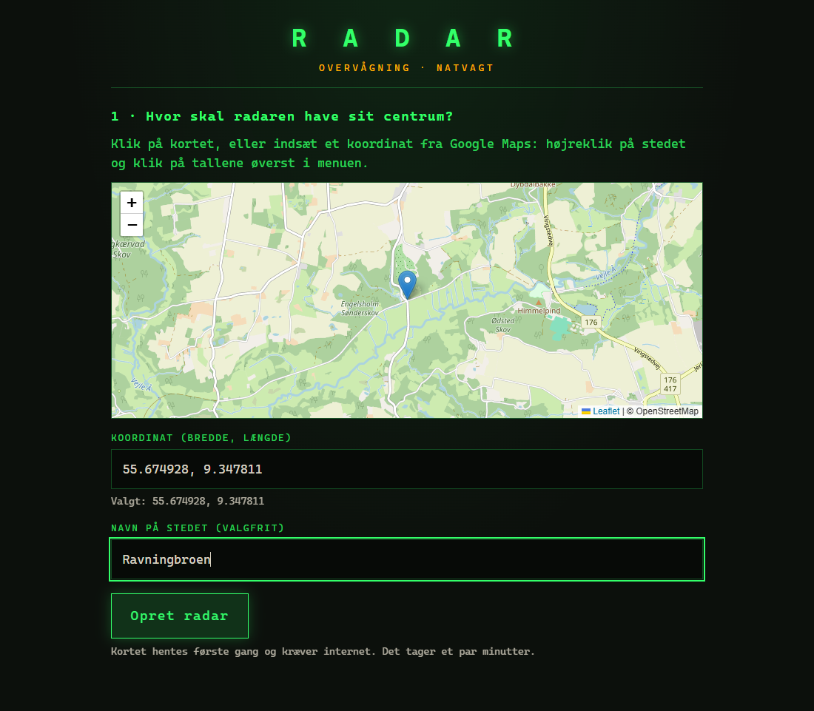
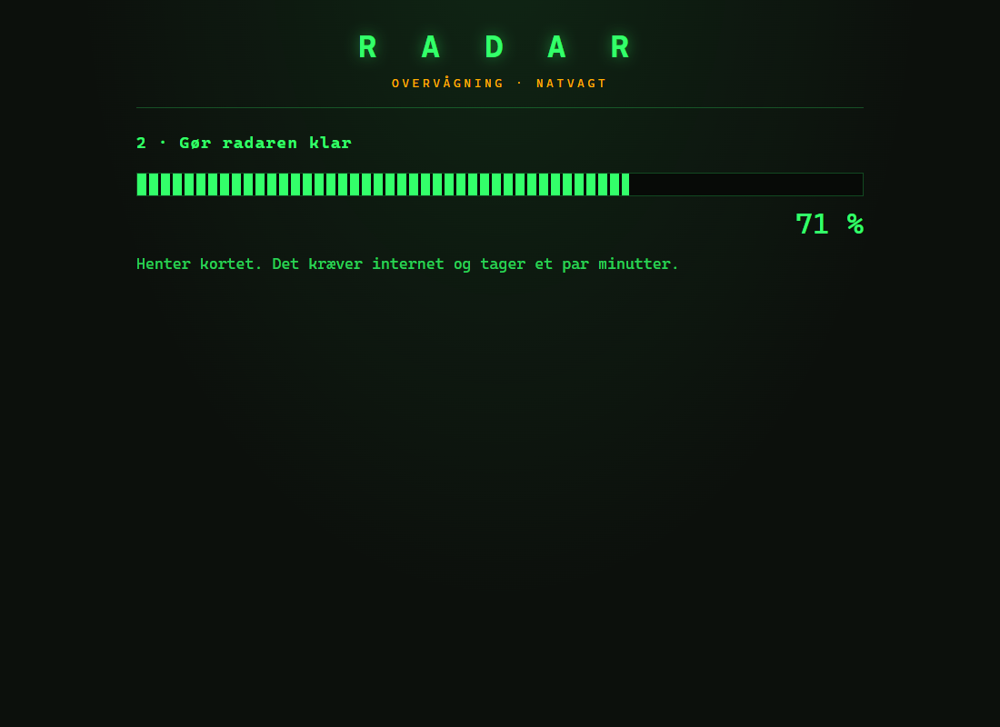
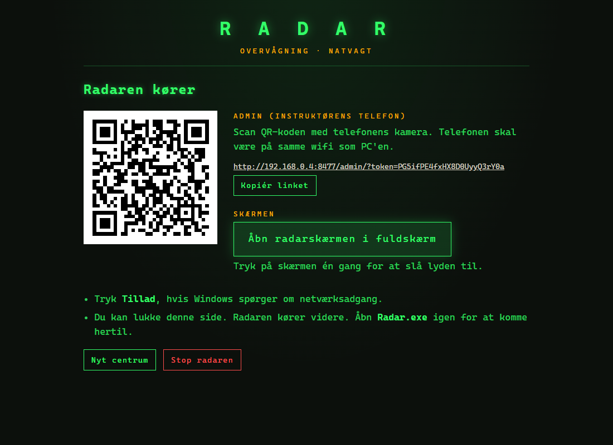
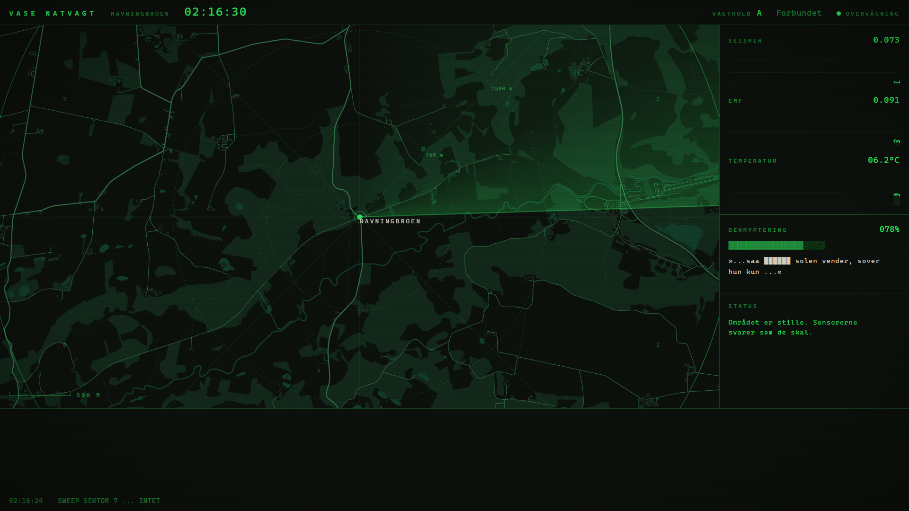
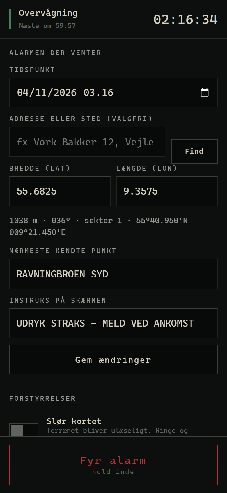
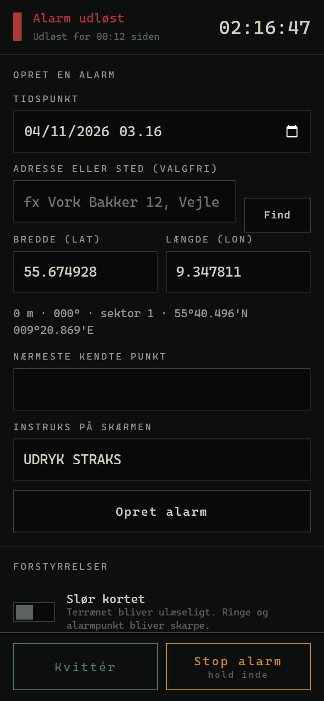

# Radar

**Et overvågningsspil til natøvelser.** Deltagerne holder vagt foran en radarskærm. På et tidspunkt, som kun instruktøren kender, falder en alarm: et rødt punkt dukker op på kortet med afstand, pejling og koordinat, og vagtholdet skal så hurtigt som muligt ud til punktet.

  <a href="https://github.com/SadlifeCaw/emergency-monitor/releases/latest"><b>⬇ Hent Radar til Windows</b></a>

- **Ingen installation.** Pak ud og dobbeltklik. Der er intet sort kommandovindue.
- **Virker uden internet.** Kortet hentes én gang, og derefter kører alt på PC'en. Falder wifi ud midt på natten, kører skærmen videre.
- **Styres i skjul fra en telefon.** Instruktøren fyrer alarmen, kvitterer og forstyrrer skærmen fra sin egen telefon.

---

## Kom i gang på 5 minutter

**Du skal bruge:** en Windows-PC, en skærm eller projektor med højttalere, og en smartphone til instruktøren. PC'en og telefonen skal være på det samme wifi (et hotspot fra telefonen er nok). Internet skal der kun være første gang, når kortet hentes.

### 1. Hent og start

1. Hent **`Radar-…-windows.zip`** fra [Releases](https://github.com/SadlifeCaw/emergency-monitor/releases/latest).
2. Højreklik på zip-filen og vælg **Udpak alle**.
3. Dobbeltklik på **`Radar.exe`**.

> Windows siger måske *"Windows har beskyttet din pc"*, fordi programmet ikke er signeret. Klik **Flere oplysninger** og derefter **Kør alligevel**.

### 2. Vælg, hvor radaren skal stå

En side åbner i din browser. **Klik på kortet** ud for stedet, eller indsæt et koordinat fra Google Maps (højreklik på stedet, og klik på tallene øverst i menuen). Giv evt. stedet et navn, og tryk **Opret radar**.

### 3. Vent, mens kortet hentes

Kortet hentes første gang og kræver internet. Det tager et par minutter, og du kan se fremdriften.

### 4. Radaren kører

Siden viser nu en **QR-kode**. Scan den med instruktørens telefon, så er telefonen inde i admin. Tryk **Åbn radarskærmen i fuldskærm** for selve skærmen, som deltagerne skal se.

- Tryk **Tillad**, hvis Windows spørger om netværksadgang. Ellers kan telefonen ikke nå radaren.
- Tryk på skærmen **én gang** for at slå lyden til.
- Du kan lukke siden. Radaren kører videre. Åbn `Radar.exe` igen for at komme tilbage hertil.

---

## Under aktiviteten

### Radarskærmen

Rolig og levende: et sweep kører rundt over kortet, målingerne bevæger sig, og loggen ruller. Af og til dukker et gult **?** op og forsvinder igen. Det er støj, og det skal deltagerne lære at skelne fra den rigtige alarm.

### Instruktørens telefon

Scan QR-koden for at åbne admin. Her opretter du alarmen: **tidspunkt** og **koordinat** (du kan også søge på en adresse). Feltet regner afstand, pejling og sektor ud, mens du taster, så et taste-slip opdages med det samme.

  
  &nbsp;
  

| Knap | Hvad den gør |
|---|---|
| **Fyr alarm** (hold inde i 2 sekunder) | Alarmen falder: sirene, rødt punkt, afstand, pejling og koordinat |
| **Kvittér** | Sirenen tier. Punktet bliver stående |
| **Stop alarm** (hold inde) | Alarmen er forbi, og skærmen er rolig igen |
| **Nulstil natten** | Alt tilbage til start. Brug den før en ny runde |

Alt, der ikke kan fortrydes, kræver, at knappen holdes inde, så en telefon i en lomme ikke kan fyre alarmen ved et uheld.

### Når alarmen falder

Sirenen lyder, og skærmen skifter til rødt. Punktet vises med **afstand**, **pejling** og **koordinat**, og en tæller viser, hvor lang tid der er gået. Vagtholdet tager kompas, lygter og radio og går ud til punktet.

Cirka fem minutter før alarmen begynder graferne at stige. Det er et varsel til dem, der følger med.

### Gør det sværere

Instruktøren kan slå forstyrrelser til og fra under aktiviteten:

| Forstyrrelse | Virkning |
|---|---|
| **Slør kortet** | Terrænet bliver ulæseligt. Ringe og alarmpunkt er stadig skarpe |
| **Skjul koordinatet** | Koordinatet flakker ud. Afstand og pejling står stadig |
| **Glitch** | Skærmen sætter ud en gang imellem |
| **Målingsforstyrrelse** | Målinger og dekryptering glitcher |
| **Lyd fra** | Alarmen kan kun ses, ikke høres |

De kan slås fra igen når som helst, så skru op lidt ad gangen.

---

## Hvis noget går galt

| Problem | Løsning |
|---|---|
| *"Windows har beskyttet din pc"* | Klik **Flere oplysninger** og derefter **Kør alligevel** |
| Telefonen kan ikke komme ind i admin | Tryk **Tillad**, når Windows spørger om netværk. Tjek, at PC og telefon er på samme wifi |
| Ingen lyd | Tryk på skærmen én gang. Tjek PC'ens lydstyrke og højttalere |
| Kortet er et gitter i stedet for et kort | Kortet blev ikke hentet. Åbn `Radar.exe`, tryk **Nyt centrum**, og vælg stedet igen, mens PC'en har internet |
| Skal bruge et andet sted | Åbn `Radar.exe`, og tryk **Nyt centrum** |
| Radaren skal stoppes | Åbn `Radar.exe`, og tryk **Stop radaren** |
| Noget andet | Se filen `radar-fejl.log` ved siden af programmet |

---

## Til dig, der vil mere

- **Signaltårne** er en valgfri udvidelse: tårne, der skal aktiveres ét for ét, og som til sidst åbner en optaget besked. Se [docs/05-udvidelse.md](docs/05-udvidelse.md).
- **Aktivitetsbeskrivelse** til kompendiet: [docs/kompendium-radar.md](docs/kompendium-radar.md).
- **Udvikling, arkitektur og kildekode:** [docs/udvikling.md](docs/udvikling.md). Programmet bygges med `npm run udgivelse`.
